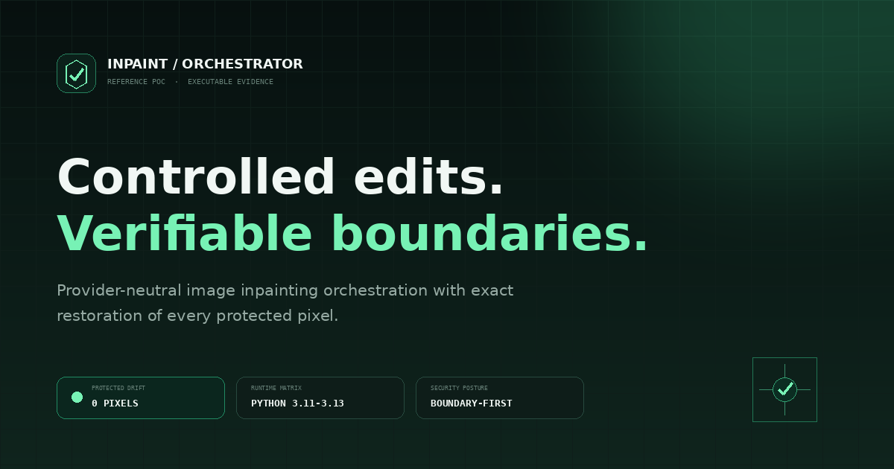
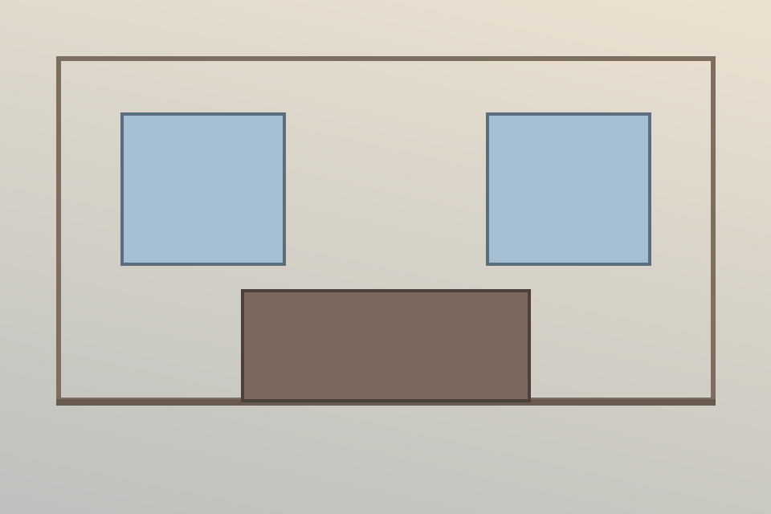
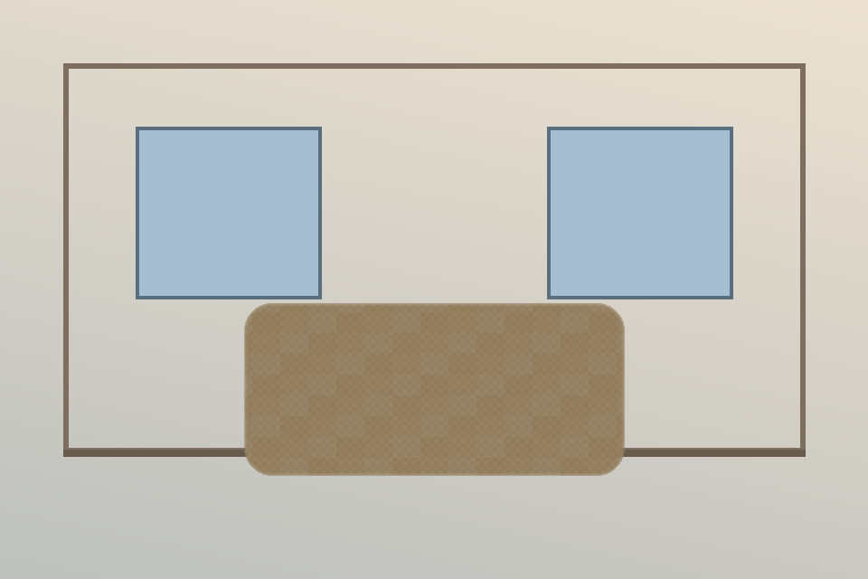

# Interior Inpainting Orchestrator — Pre-award Reference PoC

[](https://github.com/AliNaderiii/interior-inpainting-orchestrator-poc/actions/workflows/ci.yml)
[](https://github.com/AliNaderiii/interior-inpainting-orchestrator-poc/actions/workflows/pages.yml)
[](https://www.python.org/)
[](LICENSE)



A focused, security-conscious reference implementation demonstrating the deterministic portion of an interior-staging inpainting backend:

- FastAPI boundary (provisional PoC contract only)
- Pydantic v2 request metadata
- Pillow/OpenCV/NumPy image normalization and mask processing
- exact preservation of pixels outside the authorized hard mask
- provider-neutral async inpainting interface
- deterministic local demo provider for zero-cost tests
- optional Black Forest Labs FLUX.1 Fill adapter
- bounded uploads, prompts, polling, retries and result downloads
- unit, property-oriented and API tests
- non-root Docker image and CI baseline
- portfolio-grade static showcase with a browser-local boundary lab

> **Live showcase:** [Open the GitHub Pages experience](https://alinaderiii.github.io/interior-inpainting-orchestrator-poc/) — inspect the before/after proof, run the deterministic boundary lab, and review the architecture without installing anything.

> **Important:** This repository is a pre-contract reference PoC. It does not implement or claim compatibility with the client's finalized API contracts because those contracts have not been supplied. The local demo provider is deliberately non-generative and must never be represented as an AI-quality benchmark.

## GitHub Pages showcase

The `site/` directory is a dependency-free static technical showcase designed for GitHub Pages. It includes:

- an accessible, responsive, dark/light portfolio experience;
- an interactive before/after and authorized-mask inspector;
- a browser-local image + mask boundary lab with downloadable PNG output;
- architecture, security, CI evidence and explicit open-risk sections;
- no analytics, cookies, external scripts, API calls or uploaded-file transmission;
- a restrictive Content Security Policy with outbound connections disabled.

GitHub Pages serves static files only—it does **not** run the FastAPI backend or hold provider credentials. The browser lab is clearly labelled deterministic and non-AI. See [`docs/GITHUB_PAGES.md`](docs/GITHUB_PAGES.md) for deployment and review instructions.

Preview it locally:

```bash
python -m http.server 4173 --directory site
```

Then open `http://localhost:4173`.

## Security posture

- No arbitrary remote image URLs are accepted by the PoC API.
- Uploads are limited by encoded bytes and decoded megapixels.
- Animated/multi-frame images are rejected.
- EXIF orientation is normalized and metadata is stripped from output.
- White mask pixels are editable; black pixels are protected.
- Final compositing restores original pixels outside the hard mask exactly.
- Provider credentials are read only from environment variables.
- Returned provider URLs are HTTPS-only and host-allowlisted.
- Live provider tests are excluded from normal CI.

## Quick start

```bash
python -m venv .venv
# Linux/macOS/Git Bash: source .venv/bin/activate
# Windows PowerShell:   .venv\Scripts\Activate.ps1
python -m pip install -e '.[dev]'
pytest -q
uvicorn inpainting_poc.api:app --reload
```

Open `http://localhost:8000/docs`.

## Demo endpoint

`POST /poc/v1/inpaint` accepts multipart fields:

- `image`: JPEG/PNG/WebP input
- `mask`: aligned grayscale/RGB mask; white means edit, black means preserve
- `prompt`: 1–1000 characters

It returns a PNG. The default provider creates a deterministic colored texture in the editable region so that mask alignment and compositing can be verified without a paid model.

## Live FLUX.1 Fill

Set:

```bash
INPAINT_PROVIDER=bfl
BFL_API_KEY=...
BFL_RESULT_HOSTS=delivery-us1.bfl.ai,delivery-eu1.bfl.ai
```

The result host list must match the hosts actually returned for the approved BFL account/region. Do not loosen it to arbitrary HTTPS hosts. Live use requires account validation, budget approval and updated provider-contract tests.

## Deterministic mask/compositing proof

| Synthetic input | White = editable mask | Deterministic output (not AI) |
|---|---|---|
|  |  |  |

This artifact demonstrates geometry, mask polarity, inward feathering and exact restoration of protected pixels. It is deliberately **not** presented as an AI generation or visual-quality benchmark.

Regenerate it with:

```bash
python scripts/create_demo_artifacts.py
```

Temporary artifacts are written to `demo-artifacts/`; the approved synthetic documentation copies live in `docs/assets/`.

## Next step after contract award

Replace the provisional PoC API with the client-owned OpenAPI/schema baseline, run contract discovery, confirm the primary provider/model/region, and execute the approved security and delivery gates.

## License

MIT. Provider services and model outputs remain subject to their own terms, acceptable-use policies and commercial licensing.
